# NoiseLab

**Which speech noise-suppression method works best, for which kind of noise, and at what cost?**

NoiseLab compares 11 single-channel speech-enhancement algorithms, from classical spectral subtraction to deep neural networks. All of them run through the same pipeline and are scored with the same metrics on the same benchmark: real speech, synthetic and recorded noise, six SNRs and 14,520 runs.

- **Simulink model, built from scratch:** spectral subtraction (Boll 1979, with Berouti's over-subtraction and spectral floor) built from DSP System Toolbox blocks.
- **Hand-written DSP in NumPy/SciPy:** the same spectral subtraction (bit-for-bit parity with the Simulink block design), plus four statistical estimators: decision-directed Wiener, MMSE-STSA, log-MMSE and OM-LSA with IMCRA noise tracking.
- **Six third-party baselines** for reference: noisereduce, WebRTC NS, RNNoise, NSNet2, DeepFilterNet3 and Demucs.
- **An interactive web app** to record or upload audio, tune every parameter live, look inside the algorithm (spectrograms, gain masks, a per-frame STFT inspector) and compare all methods on your own clip.

The project began as a B.Tech ENTC *Model-Based Design* course project and grew into a comparative study.

## Contents

- [Key findings](#key-findings)
- [Algorithms](#algorithms)
- [Results](#results)
- [Simulink model](#simulink-model)
- [The web app](#the-web-app)
- [Getting started](#getting-started)
- [Repository layout](#repository-layout)
- [Documentation](#documentation)
- [API](#api)
- [References](#references)
- [License](#license)

---

## Key findings

From 20 LibriSpeech utterances × 11 noise types × 6 input SNRs (−5 to 20 dB):

- **Demucs gives the clearest speech.** It has the best ΔSI-SDR on 10 of 11 noise types (+10.1 dB on average) and the least spectral distortion, but it is also the most expensive model by far.
- **DeepFilterNet3 gives the best sound quality for its cost.** It has the largest ΔPESQ (+0.75) at under 2 % of one CPU core. Demucs costs 8× more for a slightly lower ΔPESQ.
- **Classical methods still win in some cases.** At 20 dB input SNR, log-MMSE has the best ΔSI-SDR (+3.80 dB), ahead of every neural model. Hand-written statistical methods also win the PESQ cells for 50 Hz hum at 10–20 dB and office noise at 5–20 dB.
- **The statistical estimators beat plain spectral subtraction.** Log-MMSE matches spectral subtraction on ΔSI-SDR, with higher ΔPESQ (+0.49 vs +0.40) and lower distortion (LSD 6.5 vs 7.2 dB), and still uses only 0.4 % of a core.
- **More noise removed does not mean better audio.** RNNoise removes the most noise in pauses (62.8 dB) but also damages speech the most, and has the lowest ΔPESQ. noisereduce made SI-SDR *worse* on fan noise and clicks.
- **Spectral subtraction's default α = 2 is well chosen.** The parameter sweep peaks at α ≈ 1.5–2.

The full tables, per-condition winners and paired Wilcoxon tests are produced by `scripts/report_figures.py`.

## Algorithms

| Family | Algorithm | Implementation |
|---|---|---|
| Classical | Spectral subtraction (magnitude/power, over-subtraction α, floor β), Wiener gain | Hand-written: [`app/dsp/spectral_subtraction.py`](app/dsp/spectral_subtraction.py) and Simulink |
| Statistical | Decision-directed Wiener · MMSE-STSA · log-MMSE · OM-LSA + IMCRA | Hand-written: [`app/dsp/statistical.py`](app/dsp/statistical.py) |
| DSP library | noisereduce (spectral gating) · WebRTC NS (the browser / Google Meet suppressor) | Wrapped: [`app/enhancers/thirdparty/`](app/enhancers/thirdparty/) |
| Neural | RNNoise (hybrid DSP + RNN) · NSNet2 · DeepFilterNet3 · Demucs (dns64) | Wrapped: [`app/enhancers/thirdparty/`](app/enhancers/thirdparty/) |

Every method exposes its own parameters through one validated schema. A shared *max attenuation* limit applies to all of them in the same way. Every wrapper returns output that is time-aligned with the input: resampling is zero-phase and known model delays are removed, so SI-SDR measures enhancement rather than latency. Every equation is derived in [`docs/ALGORITHM.md`](docs/ALGORITHM.md), and the code cites the equation numbers.

## Results

Means over all 14,520 runs. Speech is LibriSpeech read speech. Noise is 6 synthetic types (white, pink, 50 Hz mains hum, fan, babble-like, clicks) and 5 recorded DEMAND environments, mixed at −5, 0, 5, 10, 15 and 20 dB. All mixtures are seeded, and every method gets the same mixtures. The 95 % confidence intervals are about ±0.2–0.3 dB for ΔSI-SDR and ±0.03 for ΔPESQ.

| Algorithm | Speech clarity gain ↑<br>(ΔSI-SDR, dB) | Sound-quality improvement ↑<br>(ΔPESQ) | Intelligibility improvement ↑<br>(ΔESTOI) | Speech distortion ↓<br>(LSD, dB) | Noise removed in pauses ↑<br>(NR, dB) | CPU cost ↓<br>(RTF, 1 core) |
|---|---|---|---|---|---|---|
| Spectral subtraction (Simulink settings) | +5.84 | +0.40 | +0.018 | 7.23 | 24.2 | 0.0006 |
| Wiener-DD | +6.42 | +0.36 | +0.019 | 7.28 | 27.5 | 0.0020 |
| MMSE-STSA | +5.78 | +0.47 | +0.020 | 6.60 | 14.5 | 0.0043 |
| Log-MMSE | +6.25 | +0.49 | +0.021 | 6.52 | 17.9 | 0.0040 |
| OM-LSA + IMCRA | +4.65 | +0.40 | +0.030 | 6.81 | 12.4 | 0.0111 |
| noisereduce | +2.72 | +0.45 | +0.026 | 6.75 | 31.0 | 0.0032 |
| WebRTC NS | +4.64 | +0.38 | +0.007 | 7.31 | 15.1 | 0.0016 |
| RNNoise | +4.31 | +0.15 | +0.066 | 6.73 | 62.8 | 0.0232 |
| NSNet2 | +5.47 | +0.50 | +0.066 | 6.13 | 40.6 | 0.0083 |
| DeepFilterNet3 | +8.45 | **+0.75** | +0.098 | 6.41 | 47.2 | 0.0185 |
| Demucs (dns64) | **+10.05** | +0.64 | **+0.111** | **5.84** | 48.0 | 0.1433 |

RTF (real-time factor) is processing time divided by audio duration, measured on one core of an idle machine. Each term is explained in plain words in [`docs/GLOSSARY.md`](docs/GLOSSARY.md). Results are for read English speech and may differ for conversational speech, other languages or other microphones.

Click a figure to open it at full size. Each figure starts with a "How to read" line.

<table>
  <tr>
    <td colspan="2" align="center">
      <a href="docs/figures/fig3_best_per_condition.png">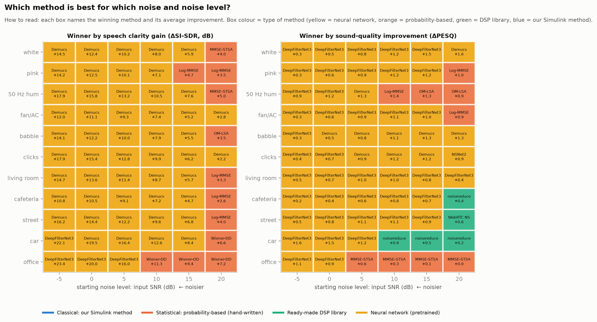</a><br>
      <sub><b>Fig. 3</b> — Which method is best for which noise and noise level?</sub>
    </td>
  </tr>
  <tr>
    <td width="50%" align="center">
      <a href="docs/figures/fig1_si_sdr_vs_snr.png">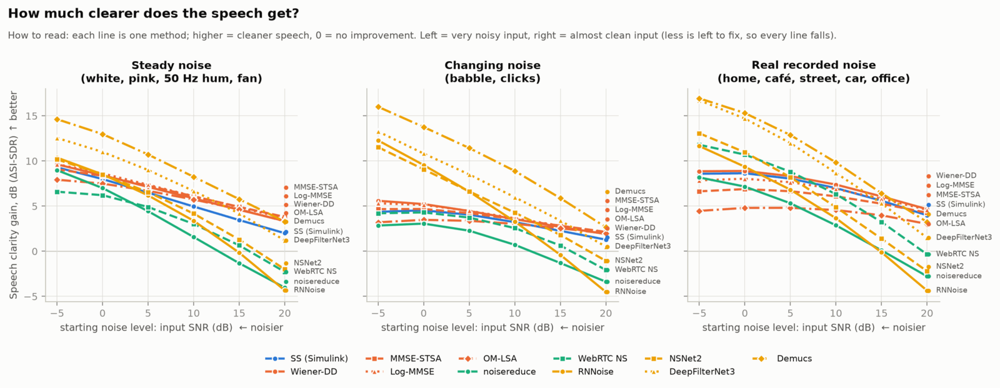</a><br>
      <sub><b>Fig. 1</b> — How much clearer does the speech get? (ΔSI-SDR vs SNR)</sub>
    </td>
    <td width="50%" align="center">
      <a href="docs/figures/fig2_pesq_estoi_vs_snr.png">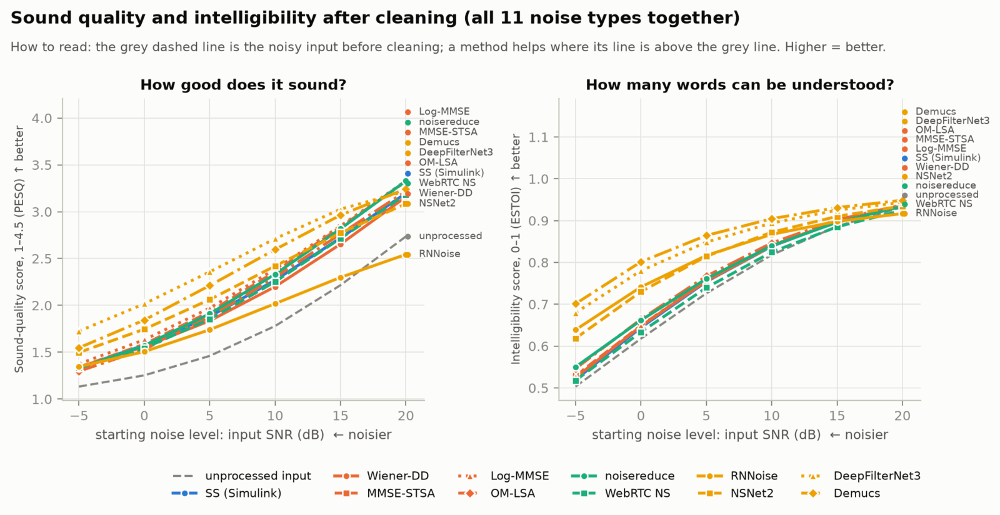</a><br>
      <sub><b>Fig. 2</b> — Sound quality and intelligibility (PESQ, ESTOI)</sub>
    </td>
  </tr>
  <tr>
    <td width="50%" align="center">
      <a href="docs/figures/fig9_heatmap_si_sdr.png">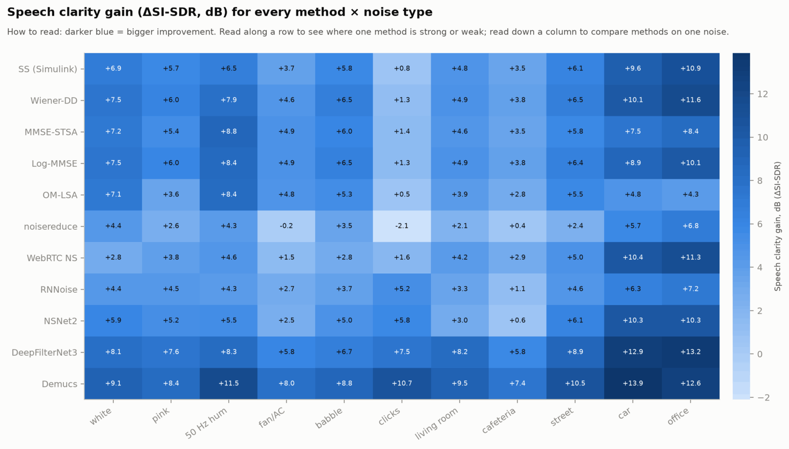</a><br>
      <sub><b>Fig. 9</b> — Speech clarity gain, method × noise type</sub>
    </td>
    <td width="50%" align="center">
      <a href="docs/figures/fig10_heatmap_pesq.png">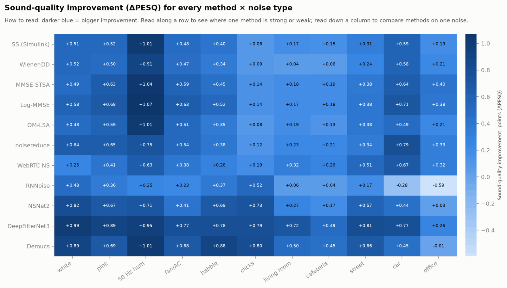</a><br>
      <sub><b>Fig. 10</b> — Sound-quality improvement, method × noise type</sub>
    </td>
  </tr>
  <tr>
    <td width="50%" align="center">
      <a href="docs/figures/fig4_tradeoff.png">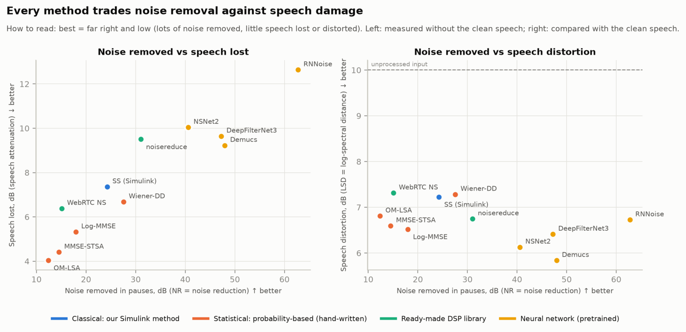</a><br>
      <sub><b>Fig. 4</b> — Noise removal vs speech damage</sub>
    </td>
    <td width="50%" align="center">
      <a href="docs/figures/fig5_quality_vs_cost.png">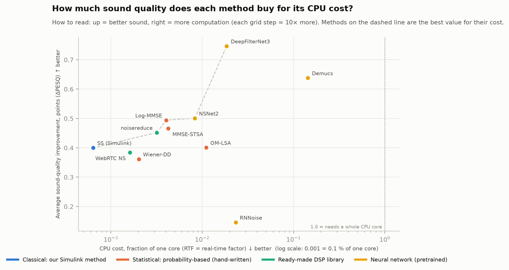</a><br>
      <sub><b>Fig. 5</b> — Sound quality vs CPU cost</sub>
    </td>
  </tr>
  <tr>
    <td width="50%" align="center">
      <a href="docs/figures/fig6_stationary_vs_nonstationary.png">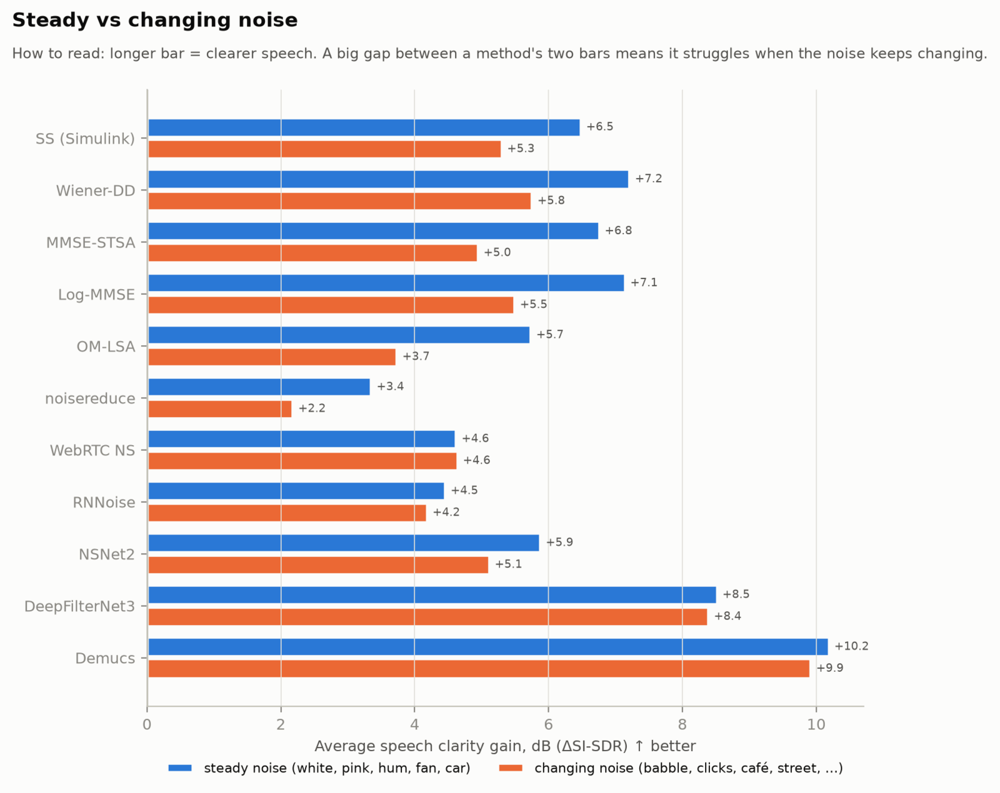</a><br>
      <sub><b>Fig. 6</b> — Steady vs changing noise</sub>
    </td>
    <td width="50%" align="center">
      <a href="docs/figures/fig11_dnsmos_vs_pesq.png">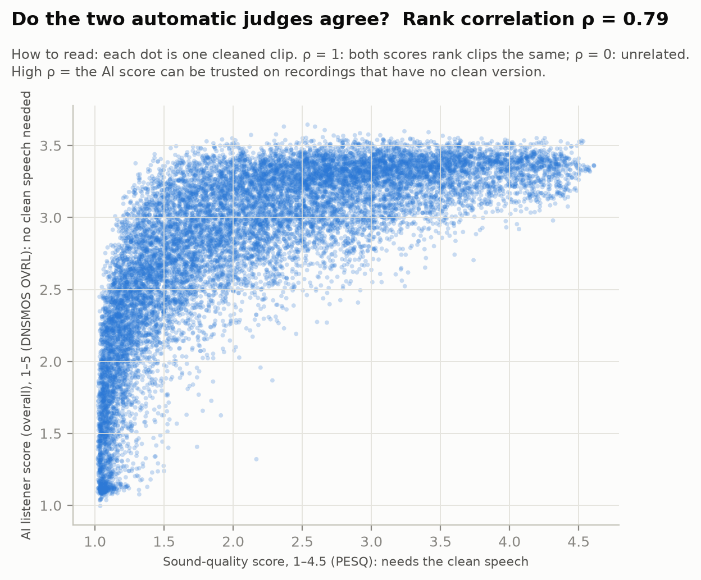</a><br>
      <sub><b>Fig. 11</b> — Do the two automatic judges agree? (DNSMOS vs PESQ, Spearman ρ = 0.79)</sub>
    </td>
  </tr>
  <tr>
    <td width="50%" align="center">
      <a href="docs/figures/fig7a_sensitivity_si_sdr.png">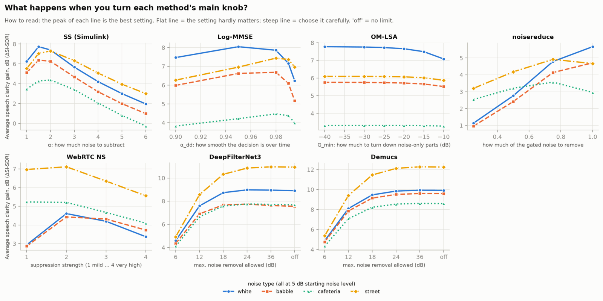</a><br>
      <sub><b>Fig. 7a</b> — Turning each method's main knob (ΔSI-SDR)</sub>
    </td>
    <td width="50%" align="center">
      <a href="docs/figures/fig7b_sensitivity_pesq.png">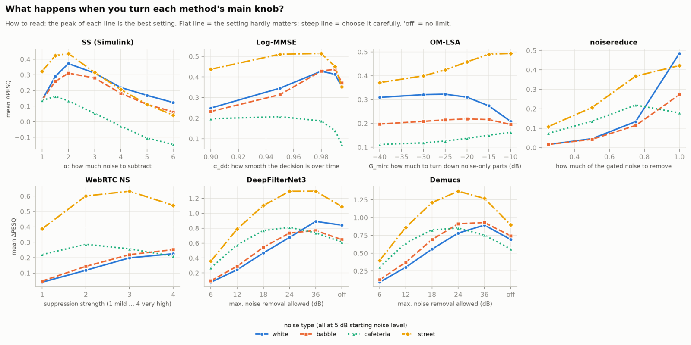</a><br>
      <sub><b>Fig. 7b</b> — Turning each method's main knob (ΔPESQ)</sub>
    </td>
  </tr>
  <tr>
    <td colspan="2" align="center">
      <a href="docs/figures/fig8_spectrograms.png">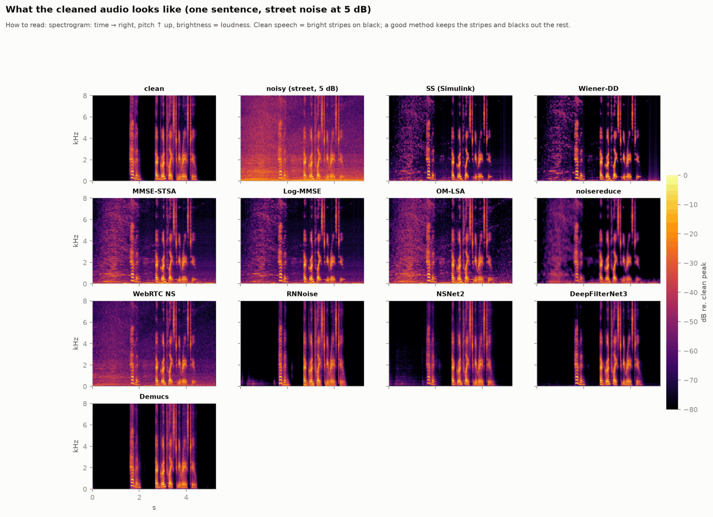</a><br>
      <sub><b>Fig. 8</b> — What the cleaned audio looks like (spectrograms)</sub>
    </td>
  </tr>
</table>

## Simulink model

Spectral subtraction is implemented from scratch in Simulink with DSP System Toolbox blocks:

```
From Multimedia File → Buffer (N = 512, 50 %) → × Hann → FFT → |·|, ∠·
   → max(|Y| − α|N̂|, β|N̂|) → recombine with noisy phase → IFFT → overlap-add → To Multimedia File
```

The noise spectrum |N̂| is estimated in the model's `InitFcn` from the first 0.5 s of the input. [`simulink/README.md`](simulink/README.md) has the full block table, the parameter values and build instructions. You can build the model by hand from the table or programmatically with `build_spectral_subtraction_model.m`.

To compare a Simulink run with the Python implementation (the web app's **Match Simulink basic** preset uses the same settings):

```matlab
addpath simulink
run_and_export('samples/noisy.wav', 'out/cleaned_simulink.wav')
```

```bash
python scripts/compare_simulink_python.py samples/noisy.wav out/cleaned_simulink.wav
```

The script aligns the two outputs and reports lag, RMS error, correlation and the SNR between them. Above 40 dB counts as a match. It also saves a comparison figure. [`samples/README.md`](samples/README.md) explains how to generate a test input.

## The web app

A Flask app with a vanilla-JS front end and no build step. Plotly, KaTeX and the fonts are vendored, so it also works offline.

- **Input:** drag-and-drop WAV/FLAC/OGG (up to 25 MB / 120 s), microphone recording with a level meter and live spectrum, or a separate noise-profile capture.
- **Demo mode:** synthetic speech-like signal + a chosen noise type and SNR. The clean reference is known, so true SNR, SI-SDR, PESQ and ESTOI are shown.
- **Live tuning:** every slider reprocesses in about 50 ms (the STFT is cached). Presets include *Match Simulink basic*.
- **Inspection:** noisy/cleaned/removed spectrograms on one colour scale, gain mask G(k, m), noise estimate vs mean spectra, frame energy with VAD shading, and an **STFT frame inspector**: click any time to see |Y|, α|N̂|, the floor and the result for that frame.
- **Listening:** an A/B player (original / cleaned / removed noise / clean reference) on one shared playhead. A **live denoise** preview runs spectral subtraction in an AudioWorklet on your microphone (≈ 11 ms latency, parity-tested against Python).
- **Comparison:** switch algorithm from a menu, or run every available method on the current clip in the *Algorithm comparison* panel: sortable table, bar chart, per-method playback and on-demand DNSMOS scores.
- **Analysis:** an α × β sweep heatmap of ground-truth improvement in demo mode, a plain-language glossary, and a Method panel with the equations.
- **Export:** a ZIP with every WAV, `params.json`, `metrics.json` and all plots as PNGs.

Reference-based metrics (SNR, SI-SDR, PESQ, ESTOI) need the clean signal, so for uploads and recordings they show **"n/a (no clean reference)"** and are never guessed. Reference-free indicators (noise reduction in pauses, VAD-based SNR estimate, DNSMOS) are shown instead. DNSMOS is always labelled as a *model-predicted* score.

Browsers allow microphone access only on `localhost` or over HTTPS. Opening the app from another device by LAN IP disables recording, and the app says why. Keyboard shortcuts: `Space` play/pause, `A` switch source, `R` record, `?` help.

## Getting started

### Core app (Python 3.10+)

```bash
python -m venv .venv && source .venv/bin/activate    # Windows: .venv\Scripts\activate
pip install -r requirements.txt
flask --app app run --debug                          # http://127.0.0.1:5000
pytest -q
```

This gives you spectral subtraction and the four statistical estimators. Some tests use Node to check the browser-side WAV encoder and the live-preview DSP; they are skipped if Node is not installed.

### Neural and library baselines (optional)

The neural models need PyTorch, and DeepFilterNet needs NumPy < 2, so they live in a separate Python 3.12 environment. The commands use [uv](https://docs.astral.sh/uv/):

```bash
uv venv -p 3.12 .venv-ml
VIRTUAL_ENV=.venv-ml uv pip install torch==2.14.1 torchaudio==2.11.0 --index-url https://download.pytorch.org/whl/cpu
VIRTUAL_ENV=.venv-ml uv pip install -r requirements-ml.txt
.venv-ml/bin/python scripts/fetch_models.py          # NSNet2 + DNSMOS ONNX (SHA-256 checked), DFN3/Demucs weights
.venv-ml/bin/flask --app app run --debug             # same app, all 11 algorithms
```

Methods whose dependencies are missing are greyed out in the UI, with the reason, and listed in `/api/health`.

### Reproducing the benchmark

```bash
.venv-ml/bin/python scripts/fetch_datasets.py        # LibriSpeech + DEMAND subsets (~870 MB download, ~50 MB kept)
.venv-ml/bin/python scripts/benchmark.py --quick     # smoke test, about a minute
.venv-ml/bin/python scripts/benchmark.py             # full grid → results/bench.csv (~1.5 h on 12 cores)
.venv-ml/bin/python scripts/benchmark.py --sweep     # parameter sensitivity → results/sweep.csv
.venv-ml/bin/python scripts/benchmark.py --timing    # serial real-time factors on an idle machine
.venv-ml/bin/python scripts/report_figures.py        # results/figures/*.png + results/summary.md
```

The benchmark is deterministic and resumable. CPU cost is measured in a separate serial pass, because parallel runs inflate timings unevenly across models. `scripts/readme_figures.sh` refreshes the compressed copies in `docs/figures/` that this page shows (needs ImageMagick).

## Repository layout

```
app/
  dsp/                 hand-written DSP (pure NumPy/SciPy): STFT, noise estimation, spectral
                       subtraction, statistical estimators, metrics, test-signal synthesis
  enhancers/           algorithm registry, quality metrics (PESQ/STOI/DNSMOS), runner
    thirdparty/        optional wrappers: noisereduce, WebRTC NS, RNNoise, NSNet2, DFN3, Demucs
  services/            audio I/O, job cache, processing pipeline
  params.py            parameter schema, validation and presets
  routes.py            pages and /api/*
  templates/, static/  UI (vanilla ES modules; Plotly, KaTeX and fonts vendored)
simulink/              model builder, run/export scripts, plain-MATLAB reference, block table
scripts/               benchmark, figures, dataset/model fetchers, Simulink comparison
tests/                 pytest suite (DSP, API, parameters, Simulink-chain emulation, JS parity)
docs/                  algorithm derivations, glossary, figures
```

## Documentation

| Document | Contents |
|---|---|
| [`docs/ALGORITHM.md`](docs/ALGORITHM.md) | The math for every hand-written method, with numbered equations cited in the code |
| [`docs/GLOSSARY.md`](docs/GLOSSARY.md) | Every metric and term in plain words |
| [`simulink/README.md`](simulink/README.md) | Block table, parameters and how to build and run the model |

## API

<details>
<summary>HTTP endpoints</summary>

| Method | Path | Purpose |
|---|---|---|
| GET | `/api/health` | Versions, supported formats, limits, available algorithms |
| GET | `/api/presets` | Presets and the parameter schema (ranges, defaults) |
| GET | `/api/algorithms` | Every algorithm: family, description, reference, parameters, availability |
| GET | `/api/glossary` | Plain-language definitions of every term |
| POST | `/api/process` | multipart `audio` + `params` (JSON) → `job_id`, `sr`, `duration`, `metrics`, `viz`, audio URLs |
| POST | `/api/reprocess/<job_id>` | `{"params": {...}}`; reuses the cached STFT |
| POST | `/api/noise-profile` | Noise-only clip → `profile_id` for `noise_mode=profile` |
| POST | `/api/demo` | Synthetic or user-supplied clean signal + noise → as `process`, plus ground-truth metrics |
| GET | `/api/frame/<job_id>?t=` | STFT frame-inspector data |
| POST | `/api/sweep/<job_id>` | α × β grid of ground-truth improvements (demo jobs) |
| POST | `/api/compare/<job_id>/<algorithm>` | Run one algorithm on the job → metrics row + audio URL |
| POST | `/api/quality/<job_id>` | DNSMOS P.835 of input and output |
| GET | `/api/audio/<job_id>/<original\|cleaned\|noise\|clean>.wav` | Audio; `noise` is the removed component y − ŝ |
| GET/POST | `/api/export/<job_id>` | ZIP of audio, parameters, metrics (and plots with POST) |

Out-of-range parameters are rejected with a 400 error rather than clamped. Uploads are identified by their content, never by file name or MIME type. Jobs are kept under random IDs and deleted after 30 minutes idle.

</details>

## References

1. S. F. Boll, "Suppression of acoustic noise in speech using spectral subtraction," *IEEE Trans. ASSP*, 27(2), 1979. [doi:10.1109/TASSP.1979.1163209](https://doi.org/10.1109/TASSP.1979.1163209)
2. M. Berouti, R. Schwartz, J. Makhoul, "Enhancement of speech corrupted by acoustic noise," *Proc. ICASSP*, 1979. [doi:10.1109/ICASSP.1979.1170788](https://doi.org/10.1109/ICASSP.1979.1170788)
3. P. Scalart, J. Vieira Filho, "Speech enhancement based on a priori signal to noise estimation," *Proc. ICASSP*, 1996.
4. Y. Ephraim, D. Malah, "Speech enhancement using a minimum mean-square error short-time spectral amplitude estimator," *IEEE Trans. ASSP*, 32(6), 1984.
5. Y. Ephraim, D. Malah, "Speech enhancement using a minimum mean-square error log-spectral amplitude estimator," *IEEE Trans. ASSP*, 33(2), 1985.
6. I. Cohen, B. Berdugo, "Speech enhancement for non-stationary noise environments," *Signal Processing*, 81(11), 2001.
7. I. Cohen, "Noise spectrum estimation in adverse environments: improved minima controlled recursive averaging," *IEEE Trans. SAP*, 11(5), 2003.
8. R. Martin, "Noise power spectral density estimation based on optimal smoothing and minimum statistics," *IEEE Trans. SAP*, 9(5), 2001.
9. T. Sainburg et al., *PLoS Comput. Biol.*, 16(10), 2020 (noisereduce).
10. J.-M. Valin, "A hybrid DSP/deep learning approach to real-time full-band speech enhancement," *Proc. MMSP*, 2018 (RNNoise).
11. S. Braun, I. Tashev, "Data augmentation and loss normalization for deep noise suppression," *Proc. SPECOM*, 2020 (NSNet2).
12. H. Schröter et al., "DeepFilterNet: perceptually motivated real-time speech enhancement," *Proc. Interspeech*, 2023.
13. A. Défossez, G. Synnaeve, Y. Adi, "Real time speech enhancement in the waveform domain," *Proc. Interspeech*, 2020 (Demucs).
14. J. Le Roux, S. Wisdom, H. Erdogan, J. R. Hershey, "SDR — half-baked or well done?," *Proc. ICASSP*, 2019 (SI-SDR).

## License

NoiseLab is released under the [GNU General Public License v3.0](LICENSE).

Vendored front-end assets in `app/static/vendor/` (Plotly.js, KaTeX, Inter, JetBrains Mono) keep their own licences, which are included alongside them. Downloaded models and datasets (LibriSpeech, DEMAND, NSNet2, DNSMOS, DeepFilterNet, Demucs) are subject to their authors' terms.
